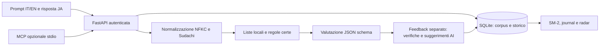

# N5 trainer · 書く

Pratica di produzione attiva del giapponese: leggi un prompt italiano o inglese,
scrivi la tua frase e ricevi controlli verificabili separati da una valutazione AI.
Open source, self-hosted, senza telemetria e senza servizi cloud obbligatori.

## Avvio locale

Richiede Python 3.12 e [uv](https://docs.astral.sh/uv/).

```sh
cp .env.example .env
# Imposta APP_PASSWORD (casuale, almeno 16 caratteri) e il provider/modello.
uv sync --frozen
make dev
```

Apri http://localhost:8000 e accedi con `APP_PASSWORD`. Migrazioni e seed vengono
applicati all'avvio. Il dizionario Sudachi viene installato durante `uv sync`, mai
scaricato al primo esercizio. Sono inclusi 24 punti grammaticali, con 24 prompt
bilingui originali, 2 coppie bilingui Tatoeba attribuite, 1.094 voci JMdict, 115 voci
KANJIDIC2 e vocaboli derivati dal mirror Tanos. Questo seed è un corpus iniziale,
NON una copertura completa di tutta la grammatica N5.

Per riprodurre le verifiche:

```sh
make check
uv run pip-audit
```

I test usano Sudachi e il rilevatore linguistico reali, SQLite temporaneo, provider HTTP e sessioni MCP simulati:
non richiedono chiavi e non consumano quota AI. La CI usa lo stesso lockfile.

## Come usarlo

- **Pratica libera**: scegli lingua, categoria e prepara una frase del dataset.
  Seleziona “Nuova frase AI” e la difficoltà per generare un esercizio con il provider configurato.
- **Ripasso in scadenza**: seleziona una frase dovuta secondo SM-2.
- **Ripasso intensivo**: ripete una frase studiata senza spostare le scadenze.
- **Punti deboli MCP**: sincronizza nelle impostazioni, poi genera una frase con le
  evidenze recuperate. La frase deve usare almeno un punto WaniKani N5 selezionato;
  l'interfaccia mostra il punto di studio invece della risposta tecnica del server.
- Mostrare un esempio registra un aiuto lato server e limita il voto SM-2 a 2.
- Storico e quaderno grammaticale conservano feedback, punto grammaticale ed evidenze MCP.
  “Ripassato” chiude una voce; una nuova osservazione la riapre.
- Il radar rappresenta dati reali delle prove: medie AI per grammatica/lessico/registro,
  quota di punti grammaticali provati, prove senza aiuto e ripassi riusciti. Non è una
  certificazione linguistica. Le evidenze MCP sono mostrate separatamente, senza
  convertire arbitrariamente percentuali di servizi diversi nei punteggi del radar.

## Configurazione AI

La lingua del prompt generato viene controllata localmente con Lingua, limitato
ad italiano e inglese. Se viene riconosciuta una lingua diversa, il generatore
riprova una volta mantenendo il significato dei riferimenti giapponesi; dopo un
secondo risultato errato l’esercizio non viene salvato. Frasi brevissime condivise
tra le due lingue possono rimanere ambigue.

Entrambi i provider devono supportare `response_format: json_schema` in modalità
strict. Output non conforme, rifiuti, timeout e risposte troncate producono un errore
esplicito; non esiste fallback a parsing di testo libero. Modelli e provider di
generazione/valutazione sono indipendenti. Provider, modelli, temperature, limiti
token, endpoint e chiavi sono modificabili nella UI autenticata.

### LM Studio / qualsiasi endpoint compatibile

Avvia il server OpenAI-compatible e carica un modello con supporto structured output.
Imposta l'identificativo reale del modello, non il segnaposto:

```dotenv
OPENAI_BASE_URL=http://localhost:1234/v1
OPENAI_API_KEY=
GENERATION_PROVIDER=openai
GENERATION_MODEL=identificativo-del-modello
EVALUATION_PROVIDER=openai
EVALUATION_MODEL=identificativo-del-modello
```

Un endpoint remoto dovrebbe usare HTTPS. Chiavi opzionali per endpoint locali;
se richieste imposta `OPENAI_API_KEY`. Il `.env` fornisce i valori iniziali, che puoi
poi sostituire nella UI. Le chiavi salvate non vengono mai restituite al browser;
lascia il campo vuoto per conservarle. Non mettere credenziali nell'URL.

### OpenRouter / provider separati

```dotenv
OPENROUTER_API_KEY=la-tua-chiave
GENERATION_PROVIDER=openai
GENERATION_MODEL=modello-locale
EVALUATION_PROVIDER=openrouter
EVALUATION_MODEL=provider/modello-con-json-schema
```

`openrouter/free` resta soggetto alla quota gratuita giornaliera e può selezionare
modelli diversi. L'app richiede provider che dichiarano supporto ai parametri inviati,
ribadisce lo schema nel prompt e valida comunque ogni risposta. Un HTTP 429 viene
segnalato come limite del provider; una risposta fuori schema non viene salvata.

Se hai già salvato le impostazioni nella UI, queste hanno precedenza sui valori
iniziali `GENERATION_*` / `EVALUATION_*` dell'ambiente. Per invertirli usa la UI.
Solo prompt, risposta, grammatica e analisi vengono inviati al provider selezionato.
Non vengono inviati password, token MCP o chiavi di altri provider. Le politiche di
retention del provider restano di sua competenza.

Documentazione: [structured outputs OpenRouter](https://openrouter.ai/docs/guides/features/structured-outputs).

## Pipeline di grading e limiti linguistici



1. Normalizzazione NFKC; tokenizzazione morfologica SudachiPy con dizionario core,
   forma dizionario, forma normalizzata, lettura, POS e informazioni di flessione.
2. Appartenenza a liste locali di kanji e lemmi; similarità Jaccard su lemmi rispetto
   alle varianti, indipendente dall'ordine; controllo di particelle di caso duplicate.
   Solo quest'ultimo è un errore grammaticale certo. Il livello lessicale è una
   proprietà della lista scelta, non una prova di correttezza. Le liste JLPT sono
   convenzioni didattiche; non si converte automaticamente il vecchio JLPT 4 in N5.
3. Il modello riceve la tokenizzazione e i controlli, valuta intento/registro e dà
   suggerimenti su particelle, flessione e ordine. Tutti i punteggi sono AI; un
   suggerimento non diventa un errore deterministico. Varianti naturali, pronomi
   omessi, kana e sinonimi devono essere accettati quando rispettano l'intento.

Non è possibile certificare in generale particelle, tutte le coniugazioni ammesse
N5 e equivalenza semantica con una lista o una similarità di lemmi. Non vengono
inventati hard fail per soddisfare artificialmente questo requisito. Il target
morfologico è comunicato al modello, ma il controllo contestuale rimane probabilistico.
Per i riferimenti generati, i vocaboli già riconosciuti come N5 con kanji fuori
lista vengono resi in kana usando la lettura morfologica, preservando la flessione.
I prestiti restano in katakana. I vocaboli non riconosciuti non vengono mascherati:
il generatore riceve i motivi dello scarto e ha un secondo tentativo, condiviso
con il controllo della lingua. Dopo due tentativi non validi l’esercizio non è salvato.

Le frasi AI sono filtrate contro le liste locali per **tutte** le varianti prima di
salvarle, ma non sono revisionate da un insegnante. Con il solo starter set il filtro
può respingere spesso le generazioni: importa le liste estese.

SM-2 usa il punteggio minimo dei quattro assi: se la risposta è accettata, qualità
3–5; altrimenti 0–2. Errori certi impediscono l'accettazione. Fallimenti ripartono
con intervallo di un giorno; successi passano a 1, 6 e poi `ceil(intervallo × ease)`.
Gli aiuti impongono qualità ≤2. Il cram non modifica SM-2.

## Dati

Vedi [DATA_SOURCES.md](DATA_SOURCES.md) e [THIRD_PARTY_LICENSES.md](THIRD_PARTY_LICENSES.md).
`make seed` è idempotente; `make update-data MANIFEST=imports/manifest.json` importa
snapshot verificati senza rete e senza sovrascrivere tentativi o ripassi. Non vengono
interrogati Jisho o altri dizionari a runtime. I sottoinsiemi attribuiti vengono importati nel seed automaticamente;
l’importazione completa richiede snapshot aggiuntivi e revisione delle mappature.

## Docker

```sh
cp .env.example .env
# Configura password e modelli. Per LM Studio sull'host:
# OPENAI_BASE_URL=http://host.docker.internal:1234/v1
# Abilita l'ascolto LAN nel server locale e limita l'accesso con il firewall.
docker compose up --build -d
docker compose logs trainer
```

Apri http://localhost:8000. Il volume `trainer-data` conserva SQLite; il processo gira
come UID 10001, filesystem applicativo in sola lettura, capabilities rimosse. Per
importare snapshot nel container, copia i file in una cartella montata in sola lettura
tramite override Compose e lancia `python -m trainer.import_data /imports/manifest.json`.

Per usare entrambi gli MCP anche in Docker, costruisci prima i bundle dei server
(vedi sotto), poi usa l'overlay che aggiunge Node e monta i bundle in sola lettura:

```sh
docker compose -f docker-compose.yml -f docker-compose.mcp.yml up --build -d
```

I percorsi predefiniti sono `../bunpro-mcp-server/dist` e `../kani-mcp-server/dist`.
Se i repository si trovano altrove, imposta `BUNPRO_MCP_DIST` e `WANIKANI_MCP_DIST`
nel `.env`. L'overlay sostituisce i comandi/percorso host con quelli Linux del
container, mantenendo i token nel `.env`. Non installa pacchetti npm a runtime.
Abilita MCP nelle impostazioni e sincronizza. Senza MCP resta sufficiente il Compose base.

## Kubernetes

```sh
docker build -t n5-trainer:local .
# Per kind: kind load docker-image n5-trainer:local
# Per altri cluster: pubblica l'immagine nel tuo registry e cambia deployment.yaml.
kubectl create secret generic n5-trainer --from-env-file=.env
kubectl apply -k k8s
kubectl port-forward service/n5-trainer 8000:8000
```

`secret.example.yaml` è solo un esempio e non viene applicato da Kustomize. Per
produzione distribuisci i segreti tramite il gestore del cluster, usa HTTPS,
`APP_ORIGIN=https://tuo-host`, `COOKIE_SECURE=true` e imposta un Ingress coerente.
Il Service è ClusterIP. Non c'è un Ingress predefinito perché dominio e controller
sono specifici dell'installazione. Una replica con strategia Recreate evita accessi
SQLite da più pod. Serve un filesystem persistente che supporti locking SQLite;
non usare un PVC NFS senza verificarne la compatibilità con WAL.

Prima di aggiornare: ferma il pod/app, fai una copia del volume completo e conserva
il vecchio tag immagine. Le migrazioni sono incrementali e non includono downgrade
automatici. Per un backup live usa l'API `sqlite3.Connection.backup`, non copiare il
solo file principale mentre WAL è attivo.

## MCP opzionale

Server supportati:
[Bunpro](https://github.com/Alexxanddr/bunpro-mcp-server) e
[WaniKani](https://github.com/Alexxanddr/kani-mcp-server).

Su host puoi avviare i pacchetti pubblici con `npx`; l'immagine Docker MCP installa
direttamente le versioni pubblicate nei registry e non dipende da checkout o directory
`dist` locali. L'app avvia ogni server via stdio su richiesta di sincronizzazione,
inizializza la sessione, legge gli strumenti consentiti e chiude il processo.

```dotenv
BUNPRO_MCP_COMMAND=npx
BUNPRO_MCP_ARGS=["-y","bunpro-mcp-server"]
BUNPRO_API_TOKEN=token-bunpro
WANIKANI_MCP_COMMAND=npx
WANIKANI_MCP_ARGS=["-y","kani-mcp-server"]
WANIKANI_API_TOKEN=token-wanikani
```

Abilita MCP nella UI, salva e sincronizza. Bunpro usa `get_weak_items` per ottenere
fino a 15 punti grammaticali e 15 vocaboli ordinati per debolezza; WaniKani usa
`list_review_statistics` sotto l'80% e risolve i primi 10 subject tramite
`get_resource`. Gli schemi dei servizi possono cambiare: un risultato vuoto non
viene trasformato in statistiche inventate. Le evidenze identificano la provenienza;
solo i dati riconosciuti sono passati al generatore, sempre come input non fidato.
I punti Bunpro e WaniKani vengono filtrati per appartenenza alle liste locali N5
prima della generazione: radicali, grammatica sopra N5 e vocaboli fuori perimetro
non vengono inviati al modello.
Se non rimangono punti compatibili, la UI lo segnala senza una chiamata AI.
L'app funziona normalmente con entrambi i server disabilitati.

## Scelte tecniche

- **Singola applicazione** Python/FastAPI con frontend HTML/CSS/JS nativo. Il nucleo
  morfologico è Python; non servono due servizi o un framework UI per sei schermate.
- **SudachiPy + dizionario core**: forma dizionario/POS/flessione reali, installazione
  riproducibile nel lockfile; niente fallback di tokenizzazione che finga morfologia.
- **SQLite** rispetto a Postgres: istanza personale, una replica, scritture brevi,
  corpus consultato localmente e setup senza servizio DB. I dizionari sono importati
  a flusso con ijson. Postgres conviene per più utenti/repliche e scritture concorrenti;
  un DB documentale non offre benefici per le relazioni tra prove, frasi e ripassi.
- SQL parametrizzato e migrazioni numerate; accessi DB raccolti in `db.py` e negli
  handler. Nessun ORM solo per promettere un cambio DB gratuito: per migrare servono
  repository espliciti, SQLAlchemy/Alembic o query equivalenti, export/import dei dati,
  test di transazione e gestione condivisa di sessioni, rate limit e lock AI.
- Font di sistema giapponesi, nessun CDN, nessun tracking, nessuna risorsa remota UI.
  Blu inchiostro, fondo azzurro carta e campo di scrittura rigato; focus visibili,
  layout mobile e annunci di stato per lettori di schermo.
- Voce, dettato, shadowing e KanjiVG sono esclusi: il flusso principale è la scrittura;
  audio aggiungerebbe permessi, modelli, dati e costi senza migliorare questo nucleo.

## Pubblicazione e CI

Il progetto è pronto per un repository autonomo. Non contiene chiavi o dati personali.
Dopo averlo pubblicato come repository pubblico, la CI esegue lint, mypy, test e
pip-audit. Il workflow Docker costruisce sulle PR e pubblica su GHCR al push su
`main` o tag `v*`; i nomi immagine sono convertiti in minuscolo. Imposta la visibilità
del package GHCR su pubblica se necessario.

Il workflow **Strix security review** è manuale per evitare spesa non richiesta.
Configura i repository secrets `STRIX_LLM` e `LLM_API_KEY`, poi avvialo da Actions.
Richiede il completamento del report; un budget esaurito non è un audit passato.
Il bootstrap usa l'installer ufficiale, che va revisionato/pinnato nel tuo ambiente.
Non è stato eseguito un pentest Strix durante la generazione del progetto.

Vedi [SECURITY.md](SECURITY.md) per threat model e [TEST_RESULTS.md](TEST_RESULTS.md) per esiti reali e limiti delle verifiche.
