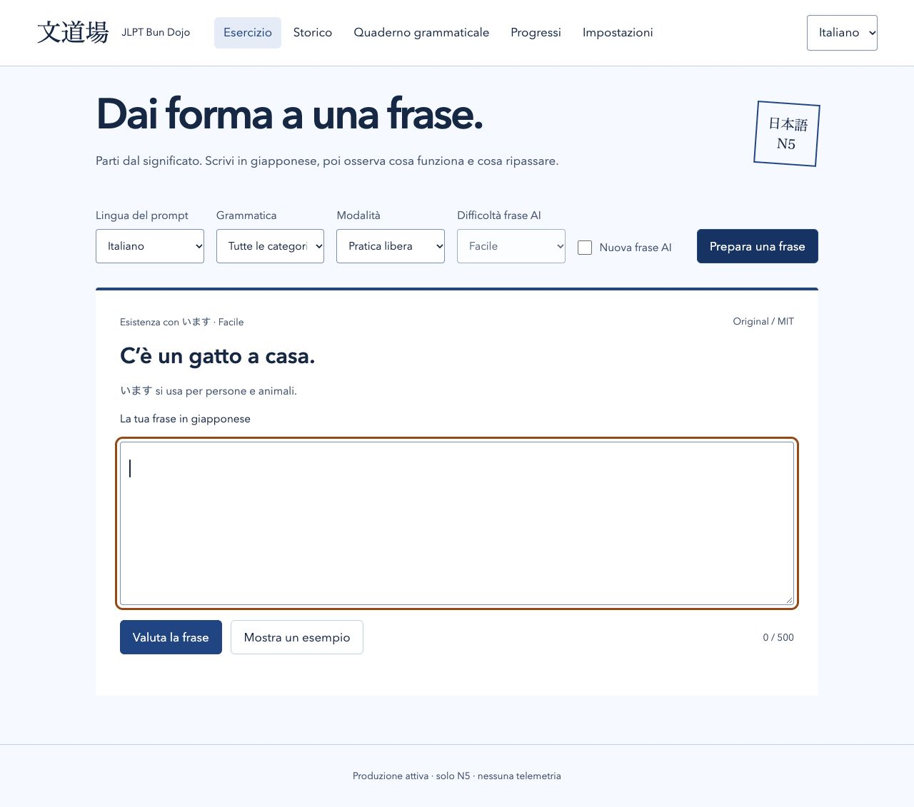
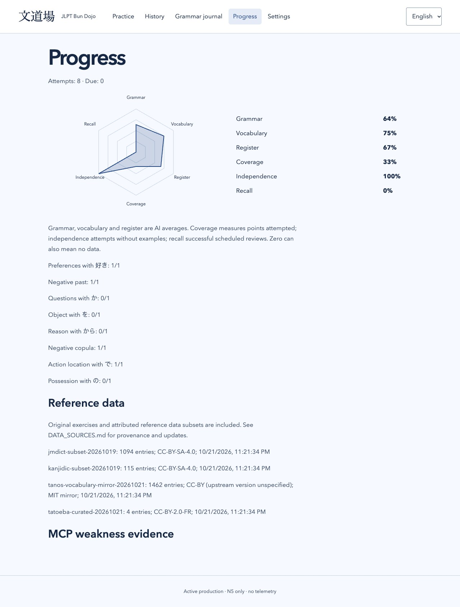
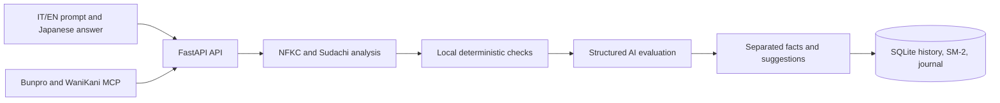

# JLPT Bun Dojo · 文道場

[](https://github.com/Alexxanddr/jlpt-bun-dojo/actions/workflows/ci.yml)
[](https://github.com/Alexxanddr/jlpt-bun-dojo/actions/workflows/docker.yml)
[](LICENSE)
[](https://www.python.org/)
[](https://jlpt-bun-dojo-demo.onrender.com/)
[](https://render.com/deploy?repo=https://github.com/Alexxanddr/jlpt-bun-dojo)

JLPT Bun Dojo is a self-hosted writing trainer for active Japanese production at
JLPT N5 level. Read a prompt in Italian or English, write the Japanese sentence
yourself, and receive deterministic language checks alongside clearly separated AI
feedback.

The application runs locally, stores study history in SQLite, has no telemetry, and
does not require a cloud AI provider. It supports OpenAI-compatible local servers,
OpenRouter, and optional Bunpro and WaniKani MCP integrations.

> [!IMPORTANT]
> JLPT does not publish authoritative vocabulary or grammar lists. The bundled seed
> is a reviewed starter corpus, not a claim of complete N5 coverage or an official
> JLPT certification tool.

## Screenshots





## Features

- Free writing from Italian or English prompts, without multiple-choice answers.
- Easy, standard, and challenging AI prompts constrained to local N5 data.
- Sudachi morphological analysis, vocabulary/kanji scope checks, and deterministic
  duplicate-particle detection.
- Structured AI evaluation for grammar, vocabulary, register, and intent.
- Strict JSON Schema responses with no free-text parsing fallback.
- SM-2 spaced repetition, cram mode, history, grammar journal, and skill radar.
- Provider, model, endpoint, keys, temperature, and token limits configurable in the UI.
- Targeted practice based on real Bunpro and WaniKani weaknesses.
- Italian and English interface and prompt languages.
- Optional instance authentication, origin checks, rate limiting, CSP, secret redaction, and a hardened
  non-root container.

## Quick start with Docker

Requirements: Docker with Compose v2.

```bash
git clone https://github.com/Alexxanddr/jlpt-bun-dojo.git
cd jlpt-bun-dojo
cp .env.example .env
```

Configure an AI provider in `.env`. For access beyond your trusted machine or network,
also set a strong `APP_PASSWORD`. Then run:

```bash
docker compose up --build -d --wait
```

Open <http://localhost:8000>. With an empty or missing `APP_PASSWORD`, the app opens
directly; when a password is configured, sign in with it.

To include the published Bunpro and WaniKani MCP packages:

```bash
docker compose -f docker-compose.yml -f docker-compose.mcp.yml \
  up --build -d --wait
```

The MCP image installs the public `bunpro-mcp-server` and `kani-mcp-server` packages
at build time. It does not depend on sibling repositories, host-specific Node paths,
or bind-mounted `dist` directories.

Docker stores SQLite in the named volume `jlpt-bun-dojo-data`. Override it with
`TRAINER_DATA_VOLUME` when migrating an existing installation.

## Local development

Requirements: Python 3.12 and [uv](https://docs.astral.sh/uv/).

```bash
git clone https://github.com/Alexxanddr/jlpt-bun-dojo.git
cd jlpt-bun-dojo
cp .env.example .env
uv sync --frozen
make dev
```

Migrations and the bundled seed run automatically on startup. Sudachi and its core
dictionary are installed from the lockfile; no dictionary is downloaded during an
exercise.

## Render demo

Try the public demo at **[jlpt-bun-dojo-demo.onrender.com](https://jlpt-bun-dojo-demo.onrender.com/)**.

The included [`render.yaml`](render.yaml) deploys a free, passwordless demo backed by
OpenRouter's free router. Render prompts for `OPENROUTER_API_KEY`; the key is never
stored in the repository or built into the image. Demo mode hides and blocks settings,
MCP synchronization, history, journal, and aggregate statistics so a public visitor
cannot read another visitor's attempts or change the shared provider configuration.

Render's free filesystem is ephemeral: exercises and attempts disappear on restart,
redeploy, or idle spin-down. Free services can take about a minute to wake after 15
minutes without traffic. Use the **Deploy to Render** button above to create your own
instance.

## Configuration

The `.env` file provides initial values. Model settings saved through the web UI take
precedence. Saved API keys are never returned to the browser; leaving a key field
empty preserves the existing value.

| Variable | Required | Purpose |
| --- | --- | --- |
| `APP_PASSWORD` | No | Optional instance password. If set, it must contain at least 16 characters. |
| `APP_ORIGIN` | Yes | Allowed browser origin, such as `http://localhost:8000`. |
| `COOKIE_SECURE` | Production | Set to `true` behind HTTPS. |
| `DEMO_MODE` | No | Restricts shared-data and configuration endpoints for a public demo. |
| `DATABASE_PATH` | No | SQLite path; defaults to `var/trainer.sqlite3`. |
| `OPENAI_BASE_URL` | Compatible providers | OpenAI-compatible `/v1` endpoint. |
| `OPENAI_API_KEY` | Provider-dependent | Key for the compatible endpoint. |
| `OPENROUTER_API_KEY` | OpenRouter | OpenRouter API key. |
| `GENERATION_PROVIDER` | No | Initial `openai` or `openrouter` provider. |
| `GENERATION_MODEL` | No | Initial generation model identifier. |
| `EVALUATION_PROVIDER` | No | Initial evaluation provider. |
| `EVALUATION_MODEL` | No | Initial evaluation model identifier. |
| `BUNPRO_API_TOKEN` | Bunpro MCP | Bunpro frontend bearer token. |
| `WANIKANI_API_TOKEN` | WaniKani MCP | WaniKani API token. |

For a model running on the Docker host:

```dotenv
OPENAI_BASE_URL=http://host.docker.internal:1234/v1
GENERATION_PROVIDER=openai
GENERATION_MODEL=your-local-model
EVALUATION_PROVIDER=openai
EVALUATION_MODEL=your-local-model
```

Both models must support strict `response_format: json_schema`. OpenRouter's free
router may select different backends and remains subject to its daily quota.

## MCP weakness targeting

Supported servers:

- [bunpro-mcp-server](https://github.com/Alexxanddr/bunpro-mcp-server)
- [kani-mcp-server](https://github.com/Alexxanddr/kani-mcp-server)

Bunpro uses `get_weak_items` for ranked grammar and vocabulary weaknesses. WaniKani
uses review statistics below 80% and resolves subject details. Before data reaches
the model, the application keeps bounded factual fields, rejects radicals and
out-of-scope items, admits Bunpro grammar marked N5, checks vocabulary and kanji
against local N5 data, balances sources/item types, and verifies that generated
references use a selected target term.

MCP content is treated as untrusted data, never as model instructions. The app works
normally with both integrations disabled.

For host execution, configure the published packages directly:

```dotenv
BUNPRO_MCP_COMMAND=npx
BUNPRO_MCP_ARGS=["-y","bunpro-mcp-server"]
BUNPRO_API_TOKEN=your-token
WANIKANI_MCP_COMMAND=npx
WANIKANI_MCP_ARGS=["-y","kani-mcp-server"]
WANIKANI_API_TOKEN=your-token
```

Enable MCP in Settings and select **Sync weaknesses** before targeted practice.

## How grading works



Deterministic findings and probabilistic AI advice stay separate. Missing vocabulary
is a dataset scope limitation, not proof that valid Japanese is wrong. All generated
reference variants are checked before saving. The generator gets one corrective retry
for wrong language, missing weakness targets, or out-of-scope vocabulary.

## Data and attribution

The bundled starter data contains 24 reviewed grammar points, 24 original bilingual
prompts, 2 attributed bilingual Tatoeba pairs, 1,094 JMdict subset entries, 115
KANJIDIC2 subset entries, and Tanos-derived N5 mappings.

See [DATA_SOURCES.md](DATA_SOURCES.md) for provenance and updates and
[THIRD_PARTY_LICENSES.md](THIRD_PARTY_LICENSES.md) for licenses. Imports are manual,
checksum-verified, and never call dictionary services at runtime.

## Kubernetes

The manifests describe a single-replica deployment with persistent SQLite storage:

```bash
docker build -t jlpt-bun-dojo:local .
kubectl create secret generic jlpt-bun-dojo --from-env-file=.env
kubectl apply -k k8s
kubectl port-forward service/jlpt-bun-dojo 8000:8000
```

The example Secret is not included by Kustomize. Use a secret manager, HTTPS,
`COOKIE_SECURE=true`, and an appropriate Ingress in production. Verify filesystem
locking before putting SQLite on network storage.

## Development and validation

```bash
make check
uv run pip-audit
docker compose -f docker-compose.yml -f docker-compose.mcp.yml config -q
kubectl kustomize k8s >/dev/null
```

Tests use real Sudachi tokenization and language detection with temporary SQLite
databases and mocked provider/MCP sessions. They require no credentials or AI quota.
CI runs Ruff, mypy, pytest, and pip-audit from the committed lockfile.

See [CONTRIBUTING.md](CONTRIBUTING.md), [SECURITY.md](SECURITY.md), and
[TEST_RESULTS.md](TEST_RESULTS.md) for contribution, security, and validation details.

## Known limits

- The starter corpus does not cover every pedagogical N5 grammar classification.
- Valid generated text can be rejected when a word is absent from the local lists.
- Very short Italian/English expressions may be ambiguous to language detection.
- Bunpro uses an unofficial frontend API whose response shape may change.
- In-memory sessions and rate limits require one application worker.

## License

JLPT Bun Dojo is released under the [MIT License](LICENSE). Bundled language data
retains its original attribution and licensing terms.
