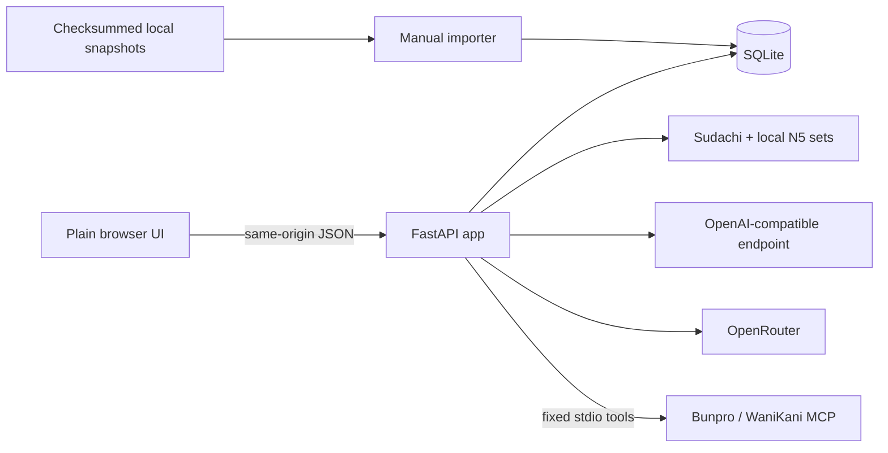
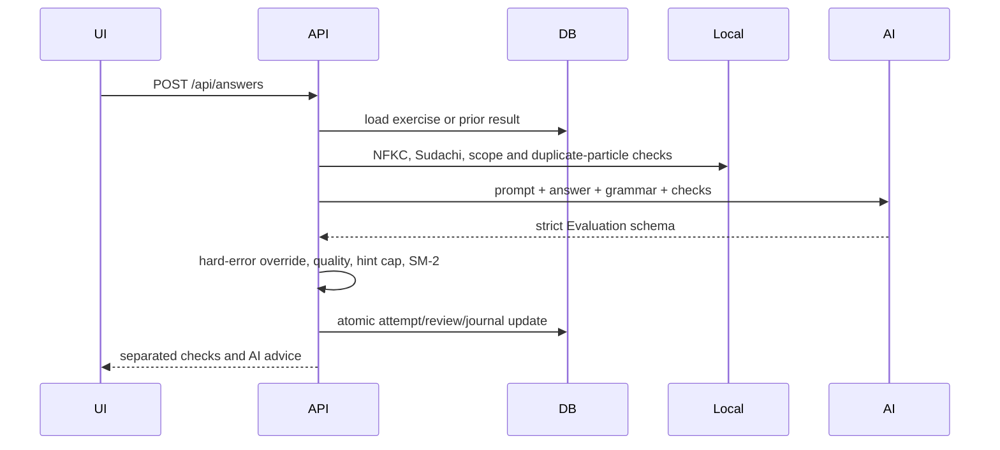

# Architecture

## Components



- `app.py` is the composition root: security middleware, routes, persistence orchestration,
  in-memory sessions/rate limit/MCP cache, and serialized AI calls.
- `models.py` defines every external request and model-output boundary.
- `ai.py` owns provider selection, prompt construction, strict transport validation, and
  corrective generation retries.
- `grading.py`, `tokenizer.py`, and `language.py` implement local analysis.
- `db.py` applies migrations then idempotently seeds/imports bundled data at startup.
- `mcp_client.py` starts administrator-selected executables but chooses tools itself.
- `static/` is a server-rendered shell enhanced by one ES module; it never renders HTML
  supplied by models.

## Generation lifecycle

```mermaid
sequenceDiagram
  participant UI
  participant API
  participant DB
  participant MCP
  participant AI
  UI->>API: POST /api/exercises
  API->>DB: select reviewed base + grammar + local sets
  opt targeted
    API->>MCP: use synchronized in-memory weaknesses
    API->>API: N5 filter, balance, compact
  end
  opt generate, targeted, or missing translation
    API->>AI: strict Generated schema
    API->>API: language, target, kanji/vocabulary checks; retry
    API->>DB: store unreviewed generated sentence
  end
  API->>DB: store opaque exercise and server references
  API-->>UI: prompt, grammar, attribution, weakness facts
```

## Evaluation lifecycle



## Dependency direction

`static -> HTTP app -> {models, db, grading, ai, mcp_client}`;
`ai -> {models, grading, language, tokenizer}`;
`grading -> tokenizer`; `db -> import_data` only during seeding;
`import_data -> {db, grading, tokenizer}`. Modules do not import the browser layer.

## HTTP boundary

All `/api/*` mutations require `X-Trainer-Request: 1`; authentication middleware applies
when configured. Request/response models and limits are defined in `models.py`.

| Method and path | Responsibility |
| --- | --- |
| `POST /api/login`, `POST /api/logout` | Create/revoke the 12-hour cookie session. |
| `GET`, `PUT /api/settings` | Return redacted settings/provider status; validate and save configuration/secrets. |
| `GET /api/grammar` | Return reviewed grammar rows ordered by ID. |
| `POST /api/mcp/sync` | Refresh the in-memory weakness cache. |
| `POST /api/exercises` | Select/generate and persist an exercise snapshot. |
| `GET /api/exercises/{id}/hint` | Mark the exercise hinted and reveal references. |
| `POST /api/answers` | Evaluate once, persist result, update review/journal, return feedback. |
| `GET /api/history` | Return the latest 100 joined attempts. |
| `GET /api/journal` | Return journal rows with localized grammar titles. |
| `POST /api/journal/{grammar_id}/resolve` | Mark one grammar observation revisited. |
| `GET /api/stats` | Aggregate axes, grammar counts, sources, due count, and weakness cache. |
| `GET /health` | Unauthenticated liveness response `{\"status\":\"ok\"}`. |
| `GET /`, `/static/*` | Application shell and immutable source assets (served with `no-store`). |

## Deployment topologies

- **Host:** `make dev`, loopback Uvicorn, `.env`, local SQLite.
- **Docker:** one non-root/read-only container plus persistent `/data`; host-bound port.
- **Docker MCP overlay:** the same runtime plus pinned published Node MCP packages.
- **Kubernetes:** one `Recreate` replica, PVC, ConfigMap/Secret, probes, resource/security
  contexts, and no service-account token.
- **Render demo:** free Docker service, ephemeral SQLite, dynamic `PORT`, passwordless
  restricted demo mode, OpenRouter free router.

All topologies require one worker. Detailed controls and trust boundaries live in
[SECURITY.md](../SECURITY.md); configuration lives in [MODELS.md](MODELS.md).
